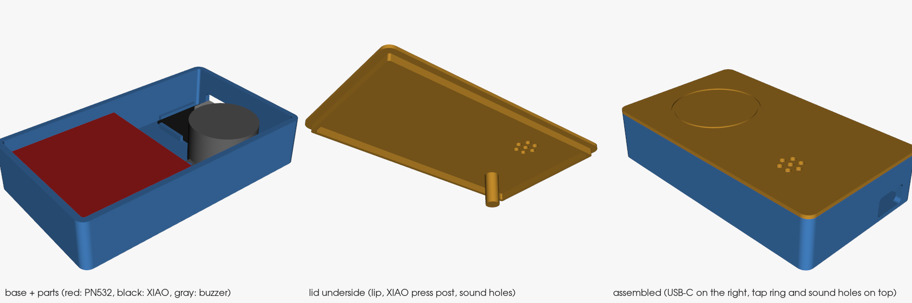

# NFC 読み取り機（XIAO RP2040 ＋ PN532 モジュール）

> 作成：2026-11-15 ／ 更新：2026-11-20（市販の XIAO RP2040 ＋ PN532 モジュールを基本とする方針に変更。自作基板は `archive/pcb/` に凍結）
> 目的：NTAG215 などの NFC カードをかざすと、番号を USB キーボードとして打ち込む読み取り機の資料



## 1. 何を作るか

- 社員証（NTAG215 シールなど ISO 14443A のカード）をかざすと、**UID（カードの番号）を 16 進で打ち込み、Enter を送る** USB キーボード型の読み取り機
- PC からは USB キーボードに見えるので、**ドライバも PC 側の設定も要らない**。MeetingLog の確認端末（`/kiosk`）にそのまま挿して使う
- 部品は市販品だけ（XIAO RP2040、PN532 NFC モジュール V3、ジャンパ線）。3D プリントのケースに入れる

### 非ゴール
- カードへの書き込み、NDEF（カードの中のデータ）の読み出し（UID だけを読む）
- Wi-Fi / BLE で送ること（必要になったら別に考える）

### 方針の変更（2026-11-20）
- PN532 ＋ ESP32-S3 の **自作基板（rev 0.2）は凍結** した。発注はしていない。資料と KiCad 一式は [archive/pcb/](archive/pcb/README.md) に、凍結した時点はタグ `pcb-rev0.2-frozen` に残している
- 理由：市販の部品の組み合わせで、実機で社員証を読めることを確かめられた（2026-11-19）。自作基板は、アンテナの調整（NanoVNA）と発注の手間・費用が大きい

## 2. 構成

```
PC ──USB-C── XIAO RP2040 ──I2C(SDA=D4, SCL=D5)── PN532 モジュール V3 ))) カード
             （USB キーボード ＋ シリアル）              （アンテナ・整合回路つき）
```

| 部品 | 例 | メモ |
|---|---|---|
| マイコン | Seeed XIAO RP2040 | USB キーボード（HID）になれる |
| NFC | PN532 NFC RFID モジュール V3（Amazon ASIN B0H6ZYCJVQ など） | 約 40×43mm。読み取り距離 4〜6cm。スイッチを I2C（SW1=ON、SW2=OFF）にする |
| ケース | [case/](case/README.md) | 3D プリント（PLA / PETG） |

### 配線（4 本）

| PN532 モジュール | XIAO RP2040 |
|---|---|
| VCC | 3V3 |
| GND | GND |
| SDA | D4 |
| SCL | D5 |

IRQ・RSTO はつながなくてよい。5V から取るときの注意は [firmware/README.md](firmware/README.md) を読む。

## 3. 打ち込む文字

| 設定 | 例 |
|---|---|
| 場所の番号なし（最初の状態） | `04A1B2C3D4E5F6` ⏎ |
| 場所の番号 12（シリアルから `LOC 12`） | `L12U04A1B2C3D4E5F6` ⏎ |

- NTAG は 7 バイトで 14 桁、MIFARE Classic などは 4 バイトで 8 桁になる
- 0〜9・A〜F・L・U だけなので、キーボードの配列（日本語・英語）によらず同じ文字が入る
- **PC の IME（日本語入力）はオフにしておく。** オンだと全角で入り、Enter が変換の確定に使われる
- 同じカードは、1.5 秒以上離してからかざすと、もう一度送る（置いたままでは送り直さない）

## 4. 書き込みと動作確認

1. Arduino IDE に **Raspberry Pi Pico/RP2040/RP2350**（Earle F. Philhower 版）のボード定義と **Adafruit PN532** ライブラリを入れる
2. ボードを **Seeed XIAO RP2040** にして、[xiao_rp2040_pn532_hid.ino](firmware/xiao_rp2040_pn532_hid/xiao_rp2040_pn532_hid.ino) を書き込む（最初の 1 回は BOOT ボタンを押しながら USB を挿す）
3. 書き込んだあとは **USB を挿し直す**（PN532 が通信の途中で固まることがあるため）
4. メモ帳を開いてカードをかざし、番号と改行が入れば OK

LED の色、シリアル（115200bps）の表示の読み方、うまくいかないときの対処は [firmware/README.md](firmware/README.md) にある。

## 5. フォルダ

| 場所 | 内容 |
|---|---|
| `firmware/` | ファームウェア（Arduino C++）と、その使い方・確かめた内容・不具合の避け方 |
| `case/` | 3D プリントのケース（STEP / STL と、それを作る FreeCAD スクリプト） |
| `archive/pcb/` | **凍結**：自作基板（PN532 ＋ ESP32-S3、rev 0.2）の設計資料・KiCad 一式・入稿ファイル |
| `TODO.md` / `glossary.md` | 残作業 / 用語集 |

## 6. 注意

- 市販の PN532 モジュールには技適の表示がない。社内の常設機器として使うかは、市販のキーボード型の読み取り機と比べて決める
- UID はコピーできるカードもある。確認端末は「読んだことの記録」用として使う（MeetingLog の `docs/nfc-card.md`「安全について」）
