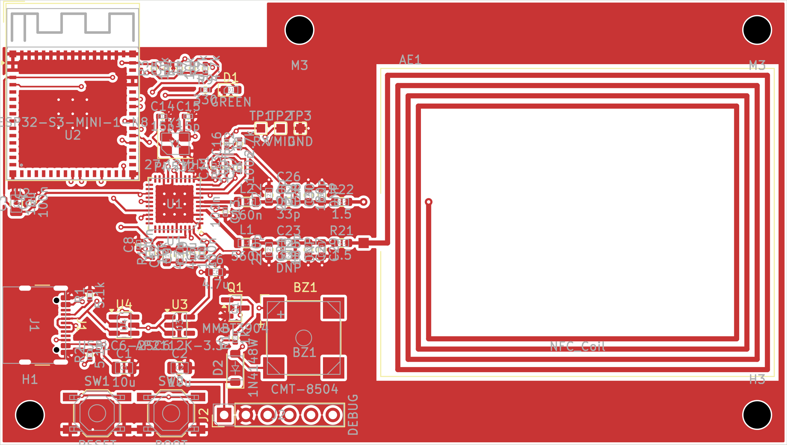

# NFCリーダー基板（PN532 + ESP32-S3）

> 作成：2026-11-15 ／ 更新：2026-11-16（rev 0.2：MCU を ESP32-S3-MINI-1 に変更、基板 92×52mm、整合部の固定配線）
> 目的：NTAG215タグを読み書きする自作NFCリーダー基板の設計資料

## 1. 何を作るか

- NTAG215（ISO14443A / NFC Forum Type 2、504バイト）のシールタグを **かざすと読み取り、USB または Wi-Fi/BLE で知らせる** 単体リーダー
  - **USB HID キーボードとして** 読み取った番号を打ち込める（ESP32-S3 の USB OTG）。PC 側にドライバやアプリが要らない
  - Wi-Fi で Webhook / MQTT に送ることもできる（同じ基板でファームウェアを切り替えるだけ）
- 基板上にアンテナを持つ1枚完結型。USB-Cで給電・書き込み
- 設計：KiCad 10 ／ 製造・実装：FusionPCB（Seeed Fusion）のPCBA

### 非ゴール
- 長距離読み取り（目標は 3〜5cm。これ以上を狙うとアンテナと電源の作り込みが大きくなる）
- 電池駆動（今回はUSB給電のみ。将来の拡張候補）

## 2. 構成（ブロック図）

```
USB-C ──┬─ ESD(USBLC6) ── D+/D- ──────────────┐
        └─ 5V ── LDO(AP2112K-3.3) ── 3.3V ─┐   │
                                          │   │
          ┌───────────────────────────────┴───┴──────┐
          │ ESP32-S3-MINI-1-N8 (Wi-Fi/BLE, USB OTG)  │
          │  GPIO38=SDA GPIO39=SCL GPIO40=IRQ         │
          │  GPIO41=RSTPDN GPIO48=LED GPIO47=BUZ      │
          │  GPIO0=BOOTボタン  EN=リセットボタン          │
          │  GPIO19/20=USB  TXD0/RXD0=デバッグヘッダ     │
          └──────────────┬───────────────────────────┘
                         │ I2C(4.7kプルアップ)
          ┌──────────────┴──────────┐   TX1/TX2   ┌──────────┐
          │ PN532 (HVQFN40)         ├─ EMC ─ 整合 ─┤ パターン  │
          │ I0=L, I1=H → I2Cモード   │   RX ← 分圧 ─┤ アンテナ  │
          │ 27.12MHz 水晶            │             └──────────┘
          └─────────────────────────┘
```

## 3. 回路の要点

| ブロック | 内容 | メモ |
|---|---|---|
| 電源 | USB-C 5V → AP2112K-3.3（600mA） | ESP32-S3 送信時ピーク約350mA＋PN532約150mA。入出力に10µF |
| USB | USB-C 受け（CC1/CC2に5.1kΩプルダウン）→ USBLC6-2SC6 → ESP32-S3 の GPIO19(D-)/GPIO20(D+) | S3 は同じピンで **USB Serial/JTAG（書き込み・ログ）** と **USB OTG（HIDキーボード等）** をファームウェアで切り替える。USB-UART変換ICは不要 |
| MCU | ESP32-S3-MINI-1-N8（フラッシュ8MB、PSRAMなし、15.4×20.5mm） | KiCad 標準シンボル `RF_Module:ESP32-S3-MINI-1`（フットプリントは同外形の `ESP32-S2-MINI-1`）。ストラップ GPIO3/45/46 は未接続（内部プル）。GPIO26・33〜37 は PSRAM 付き品と互換を保つため使わない |
| PN532 電源 | VBAT・PVDD に3.3V。内蔵LDOの出力 DVDD(39) を AVDD(8)・TVDD(5) に配線 | デカップリング：VBAT/TVDD に 4.7µF+100nF、DVDD・AVDD・PVDD に各100nF（データシート Fig.19/51）。TVDD の 100nF(C13) は TVDD ピンの直近（整合部2列の間）に置く |
| PN532 モード | **I0=GND、I1=3.3V → I2C**（Selif=10b、データシート Table 72）。アドレス 0x24 | IRQ(P70_IRQ, 25) と RSTPD_N(38) を ESP32 の GPIO へ。TESTEN(18) は GND |
| 未使用ピン | SVDD(37)・SIGOUT(35)・AUX1/2・P3x・RSTOUT_N は未接続、SIGIN(36) は GND、LOADMOD(2) は未接続 | |
| 水晶 | 27.12MHz、3225サイズ、CL=10pF（データシート Table 298）→ 負荷コンデンサ 15pF×2 | 型番 SCTF S3B27.120000F1010F30（LCSC C439059）。**発注前にデータシートで CL=10pF を確認** |
| アンテナ整合 | 差動。EMCフィルタ L0/C0 → 直列C1 → 並列C2 → ダンピング抵抗Rq → コイル | 値は §4。L0 は巻線型 500mA 品（積層フェライトの 150mA 品は TX 電流に対して余裕がない） |
| RX | フィルタ出力（**TX2 側**、L0とC1の間）→ R2 2.7kΩ → CRx 1nF → RX(10)、RX → R1 1kΩ → VMID(9)、VMID → Cvmid 100nF → GND | 値は Fig.51。PN532 の RX/VMID ピンは TX2 側にあるので、短く引ける TX2 側から取る（rev 0.1 は TX1 側）。実機で RX 波形を確認する |
| UI | LED（GPIO48）、電磁ブザー CUI CMT-8504（GPIO47→NPNトランジスタ駆動＋還流ダイオード） | |
| ボタン | EN（リセット）、GPIO0（BOOT） | |
| デバッグ | J2 1×6 ピンヘッダ（**未実装**、必要なときに手はんだ）：3V3 / GND / TXD0 / RXD0 / SDA / SCL | I2C を外部のロジアナや別基板の PN532 につなげる |
| テストポイント | TP1=RX、TP2=VMID、TP3=GND（1mm 角パッド） | TX1/TX2・TXF1/TXF2 は L1/L2 の両端パッドで測れる |

## 4. アンテナ（`antenna_calc.py` の計算結果）

| 項目 | 値 |
|---|---|
| コイル | 外形 45×35mm、4巻、線幅/線間 0.6/0.6mm、1oz銅。**端子は左辺の中央に上下対称（間隔 4.8mm）** |
| インダクタンス La | 約 1.34µH（素のQ ≈ 127） |
| ダンピング抵抗 Rq | 片側 1.5Ω（Q≈30 に落とす） |
| EMCフィルタ | L0 = 560nH、C0 = 220pF（fc ≈ 14.3MHz、データシート Fig.51 の値） |
| 整合 | C1 = 33pF、C2 = 180pF（片側。左右対称に2組ずつ。データシートの範囲 10〜300pF に入る） |

- rev 0.2 でコイルの巻き始め・巻き終わりを「左下の角」から「左辺の中央」に移した。巻数と線の長さはほぼ同じ（差は約 +1mm）なので計算値はそのまま使う
- 計算値はあくまで出発点。**C1/C2 は並列2パッド**（C25〜C30 は未実装の予備）にして、実測しながら値を足し引きできるようにする
- 寸法を変えたら `python antenna_calc.py` を再実行して値を出し直す

## 5. 基板レイアウト



- **サイズ**：**92×52mm**（rev 0.1 は 100×60mm。面積で約2割減）、2層、1.6mm、1oz、表面処理はHASL(鉛フリー)
- **配置**：左上に ESP32-S3-MINI-1（アンテナを基板の上端に合わせる）、中央左に PN532、右に NFC コイル、左下に USB-C・電源、下中央にブザー・デバッグヘッダ
- **ESP32 のアンテナ**：モジュールのアンテナ部の下と左右 15mm（フットプリントのキープアウト）は銅箔なし。基板上端の x=0〜31mm、幅 5mm の帯に部品・配線を置かない
- **NFCコイルの内側と真下には銅箔を置かない**（GNDベタを抜く）。ベタがあると渦電流でインダクタンスもQも落ちる
- **整合部は手配線で固定**（`gen_pcb.py` の `add_rf_routes`）：
  - PN532 の TX ピン側（右辺）をコイルへ向け、TX2 列（上）と TX1 列（下）を **コイル中心線に対して鏡像** に並べる。列の間隔 4.8mm＝コイル端子の間隔なので、L0→C1→Rq→コイル端子までまっすぐ一直線
  - 直列部品（L0・C1・Rq）は列の上、並列部品（C0・C2 とその予備）は列の外側に置き、GND ビアはさらに外側
  - TX2 はピンから水平にそのまま、TX1 はピンから 0.8mm 出て 45° で列へ下りる（ピン配置の都合で、PN532 直近の約 1.7mm だけ長さが違う）
  - TVDD の 100nF は2列の間、TVDD ピンから 2mm 以内
  - 表面の2列の間には自動配線の線を通さない（ルールエリア）。**裏面は禁止していない**（禁止すると Freerouting が 10本前後引き残すため）。裏面には上下をつなぐ信号線が数本、整合部の下を横切る
- 部品はすべて表面（片面実装）。デバッグヘッダ J2 だけスルーホールで未実装
- 四隅（左上はESP32のため x=35mm）に M3 の取付穴
- 小さな受動部品・IC の部品番号はシルクではなく組立図（F.Fab）に出す（シルクの重なりをなくすため）
- **社員証をかざす位置**：コイルの中にシルクで「社員証をここにかざす / TAP CARD HERE (3-5cm)」。ケースを作るときは、コイル外形（45×35mm）の中心にカードの中心が来るよう、天面に浅いくぼみ（カード 85.6×54mm より各辺 1mm 大きい）を設ける。天面の厚さは 2mm 以下（読み取り距離 3〜5cm の内側に収める）。ケースに金属は使わない

## 6. 製造（FusionPCB）

- 入稿するもの：ガーバー（RS-274X）＋ドリル（Excellon）を zip、BOM（Fusion のテンプレート、型番入り）、CPL（部品の座標・回転・面）
- KiCad の `.pos` 出力を Fusion の列名に合わせて直す。**回転角のずれ** はプレビューで必ず確認する
- BOM は `kicad/bom_kicad.csv`（MPN と LCSC 番号入り。未実装の予備パッドと J2 は除外済み）
- PN532 と ESP32-S3-MINI-1 は Fusion が型番で調達する。在庫・価格は見積もりの時点で確認する

## 7. ファームウェア（概要）

- Arduino-ESP32（ボード設定 ESP32S3 Dev Module、USB Mode = USB-OTG (TinyUSB)）+ Adafruit_PN532（I2C）でUIDとNTAG215のページを読み書き
- 読み取り → ブザー音とLEDで知らせる → 次のどちらか
  - **USB HID キーボード**：番号と Enter を打ち込む（PC 側はキーボード入力として受け取るだけ）
  - **Wi-Fi**：Webhook/MQTT を送信（送り先は後で決める）
- 書き込み：USB-OTG モードのままだと USB Serial/JTAG が使えないので、BOOT を押しながら RESET を押して離すと書き込みモードに入る

## 8. ファイルと作り直し方

| ファイル | 内容 |
|---|---|
| `README.md` | 本書（設計資料） |
| `design.py` | **部品と接続の唯一の定義**。回路を変えるときはここを編集する |
| `antenna_calc.py` | アンテナ・整合回路の計算（寸法はここが基準） |
| `gen_coil.py` | コイルのフットプリントとライブラリ表を生成 |
| `gen_sch.py` | `design.py` から回路図を生成 |
| `gen_pcb.py` | 基板の外形・部品配置・設計ルール・固定配線（整合部・コイル橋・GNDビア）・配線禁止エリア・かざす位置のシルクを生成 |
| `route.py` | Freerouting で自動配線し、両面にGNDベタを張る（固定配線と配線禁止エリアは残す） |
| `plot_routes.py` | 配線確認用の図（routes.png）を描く |
| `export_3d.py` | 3Dデータ（`kicad/3d/` の STEP・GLB）と3D画像を書き出す。標準ライブラリに3Dモデルが無い部品は、ESP32-S3-MINI-1 を Espressif 公式モデル（出典は kicad/3d/models/README.md）、PN532 を同外形の QFN-40、ブザーを外形寸法だけの箱で代用（元の基板ファイルは書き換えない） |
| `kicad_lib.py` | KiCadライブラリを読む補助モジュール |
| `kicad/` | KiCadプロジェクト（回路図、自作フットプリント、KiCad出力のBOM） |
| `TODO.md` / `glossary.md` | 残作業 / 用語集 |

必要なもの：KiCad 10（ユーザーごとのインストール。別の場所なら環境変数 `KICAD_DIR`）、Freerouting 2.5.0 の jar と Java 25（`%LOCALAPPDATA%\freerouting-cli\app\` と `...\jre\`。Java の場所は環境変数 `FREEROUTING_JAVA` でも指定できる）

```powershell
python antenna_calc.py   # 定数の確認
python gen_coil.py       # コイル生成
python gen_sch.py        # 回路図生成
& "$env:LOCALAPPDATA\Programs\KiCad\10.0\bin\python.exe" gen_pcb.py   # 基板生成（配線は消える）
& "$env:LOCALAPPDATA\Programs\KiCad\10.0\bin\python.exe" route.py --passes 100   # 自動配線＋GNDベタ
& "$env:LOCALAPPDATA\Programs\KiCad\10.0\bin\kicad-cli.exe" sch erc kicad\nfc_reader.kicad_sch   # 接続チェック
& "$env:LOCALAPPDATA\Programs\KiCad\10.0\bin\kicad-cli.exe" pcb drc kicad\nfc_reader.kicad_pcb --severity-all   # 基板チェック
& "$env:LOCALAPPDATA\Programs\KiCad\10.0\bin\python.exe" export_3d.py   # 3Dデータ（STEP・GLB）と3D画像
```

- Freerouting の結果は実行ごとに少し変わる。DRC で未配線や違反が出たら `route.py` をもう一度実行する（rev 0.2 は1〜2回で 0 件になった）

### 設計変更の記録
- ESP32-C3-MINI-1 → **ESP32-C3-WROOM-02**（KiCad標準ライブラリにシンボル・フットプリントがあり、自作ミスのリスクを避けるため）
- ブザー MLT-8530 → **CUI CMT-8504**（同じく標準フットプリントがあるため）
- PN532 の I2C 設定を **I0=L, I1=H** に訂正（データシート Table 72）
- EMCフィルタ C0 を 150pF → **220pF**（データシート Fig.51）。それに伴い整合 C1 は 27pF → **33pF**
- **rev 0.2（2026-11-16）**
  - ESP32-C3-WROOM-02 → **ESP32-S3-MINI-1-N8**：USB OTG で HID キーボードになれる（C3 は USB Serial/JTAG だけで HID になれない）。モジュールが小さく、アンテナのキープアウトも小さい。KiCad 標準ライブラリにある
    - それに伴い GPIO を割り当て直し（SDA=38、SCL=39、IRQ=40、RST=41、LED=48、BUZ=47、BOOT=0）。C3 用のストラップ抵抗 R5/R6（GPIO2/8）は削除
  - 基板 100×60mm → **92×52mm**
  - コイルの端子を左辺の中央に上下対称に移し、**整合部を固定配線で左右（上下）対称・一直線に**（rev 0.1 は自動配線で遠回り・非対称、TX2 だけ部分的に手配線）
  - RX 経路の取り出しを TX1 側 → **TX2 側** のフィルタ出力に（RX/VMID ピンに近い側）
  - TVDD の 100nF を TVDD ピンの直近（2列の間）へ。PN532 の放熱パッドに GND ビア 3×3、ESP32 モジュール裏の GND パッドに GND ビア
  - テストポイント TP1〜3（RX / VMID / GND）、デバッグヘッダ J2（UART0 + I2C、未実装）を追加
  - 型番を決定：水晶 S3B27.120000F1010F30（C439059）、L0 FHW0805UFR56JST（C304279、巻線 500mA）、タクトSW TL3342F160QG/TR（C2918453）、LED KT-0603G（C12624）、ESP32-S3-MINI-1-N8（C2913206）。部品表に LCSC 番号の欄を追加
  - シルクの重なり（rev 0.1 は 47件の警告）を解消：受動部品・IC の部品番号を組立図（F.Fab）へ。DRC は警告も含めて 0 件
  - 古い部品表の下書き `bom.csv`（rev 0.1 以前の番号・ESP32-C3-MINI のまま）を削除。部品表は `kicad/bom_kicad.csv` に一本化
  - `kicad_lib.py` / `route.py` のパスを作者の PC 固有から `%LOCALAPPDATA%` 基準に

## 9. PN532 の供給状況と代わりの選択肢

- **NXP は PN5321A3HN を「新規設計非推奨（NRND）」としていて、後継として PN7160 を勧めている**。すぐ廃止ではなく LCSC 等で入手はできるが、将来の供給リスクがある
- 今回 PN532 のままにした理由：NTAG215 の UID を読むだけなら性能は十分で、Arduino の実績あるライブラリ（Adafruit_PN532）が使え、整合回路の資料も多い。少量の試作なら入手できる

| 選択肢 | 良い点 | 気になる点 |
|---|---|---|
| **PN532（今回）** | ライブラリと作例が多い。I2C で簡単 | NRND。外付け整合回路の調整が要る |
| PN7160 | NXP の現行品・PN532 の後継。NCI インターフェースで NFC Forum タグ全般に対応 | ESP32 向けライブラリが少なく、NCI の実装が要る。回路・整合も作り直し |
| 既製アンテナ付きモジュール（PN532 / PN7150 ブレイクアウト等） | RF 調整済み。基板側は I2C の4本だけ | 基板1枚完結にならない。モジュールの品質・供給がまちまち |

- 量産や長期供給が要るなら PN7160 版を別ブランチで起こすのがよい（`design.py` の PN532 ブロックと `gen_pcb.py` の整合部を差し替える）

## 10. 届いたあとの RF 調整（NanoVNA）

1. まず電源（3.3V）→ ESP32 書き込み → PN532 のファームウェアバージョンを読む
2. **アンテナ＋整合部の測定**：PN532 の電源を切り、L1・L2（0805）を外す。L の TXF 側パッド（TXF1・TXF2）に 1:1 バラン経由で NanoVNA をつなぎ、TXF1–TXF2 間を差動で測る（GND は近くの C21/C22 の GND ビア）
3. 13.56MHz で実部がおよそ 2×25Ω＝50Ω・虚部が 0 付近になるよう、C25〜C30 の予備パッドに C を足して C1/C2 を追い込む（目標 25Ω/片側は `antenna_calc.py` の仮の値。PN532 の推奨範囲と照合する）
4. L1/L2 を戻し、TP1(RX) の波形をオシロで確認（データシートの RX 入力範囲に入っているか）。読み取り距離を実測して記録する
