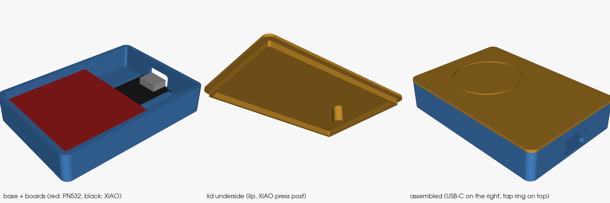

# ケース（PN532 モジュール V3 ＋ XIAO RP2040）

> 作成：2026-11-16 ／ 目的：`firmware/xiao_rp2040_pn532_hid` の読み取り機を入れる 3D プリント用ケース



## ファイル

| ファイル | 内容 |
|---|---|
| `nfc_case_base.step` / `.stl` | 本体（底と壁。PN532 のボス・支え柱、XIAO のガイド、右の壁に USB-C の穴） |
| `nfc_case_lid.step` / `.stl` | 蓋（上板 1.2mm、内側に入るリップ、XIAO の押さえ柱、かざす位置の輪の溝） |
| `nfc_case_assembly.step` | 本体・蓋・基板の目安（箱）を重ねた組立図。CAD で中身との位置を見る用。印刷はしない |
| `gen_case.py` | 上のファイルを作る FreeCAD のスクリプト（寸法はここの定数） |
| `render_case.py` | 確認用画像 `preview_case.png` を描く |

外形は **約 70 × 48 × 13.6mm**（本体 12.4mm ＋蓋 1.2mm）。

## 中の並び

- 上から見て **左に PN532**（アンテナの面を上）、**右に XIAO RP2040**（部品面を上、USB-C を右の壁へ）
- PN532 は対角の取付穴 2 つをボスに **M3 のタッピングねじ（長さ 6mm 前後）** で留め、残りの角 2 つは柱で支える。基板の下は 6mm あけて配線を通す
- XIAO は底に置くだけ。左右のガイドと奥の止めで位置が決まり、蓋の柱が上から押さえる
- 蓋は差し込み式（リップ）。カードは **蓋の上の輪のあたりにかざす**（PN532 のアンテナの真上。蓋の厚さ 1.2mm）

## 印刷

- 材料は PLA か PETG。**金属を含む材料（メタル入りフィラメント）は使わない**（電波が通りにくくなる）
- 本体は底を下、蓋は上面（輪の溝のある面）を下にして置く。サポートは不要の見込み（USB-C の穴の上辺は短い橋渡し）
- 層の高さ 0.2mm、壁 3 周、充填 15〜20% で十分

## 組み立て

1. PN532 のスイッチを I2C（SW1 = ON、SW2 = OFF）にする
2. PN532 の I2C の穴（GND・VCC・SDA・SCL）に線を **直接はんだ付け** する（ピンヘッダを立てると蓋に当たる）。線は 10cm 程度の細いもの
3. 線を XIAO の 3V3・GND・D4（SDA）・D5（SCL）にはんだ付けし、XIAO を本体のガイドの間に置く（USB-C を穴に合わせる）
4. PN532 をボスに載せてねじで留める（線は基板の下を通す）
5. 蓋を差し込む。書き込み（BOOT ボタン）のときは蓋を外す

## 実物に合わせて直すところ

寸法の一部は **商品画像から読んだ値** なので、届いたらノギスで測り、違えば `gen_case.py` の定数を直して作り直す。

| 定数 | いまの値 | 測るところ |
|---|---|---|
| `PN_W`, `PN_H` | 40.0, 43.0 | PN532 基板の横・縦 |
| `PN_HOLES` | (32.5, 7.3), (7.9, 34.6) | 取付穴の中心（基板の **左上の角** から右へ・下へ。I2C の 4 ピンが上の辺に来る向き） |
| `PN_HOLE_D` | 3.2 | 取付穴の径（M3 が通らなければ `BOSS_PILOT` も合わせて変える） |
| `XI_TOP`, `USB_CZ` | 3.6, 2.6 | XIAO の底から USB-C の上面・中心まで |

```powershell
& "C:\Program Files\FreeCAD 1.0\bin\freecadcmd.exe" case\gen_case.py        # STEP / STL を作り直す（干渉の確認も出る）
& "C:\Program Files\FreeCAD 1.0\bin\python.exe" case\render_case.py        # 確認用画像
```

- `gen_case.py` は最後に、本体・蓋と基板の目安が重なっていないか（干渉 0 mm³）を表示する
- 蓋がきついときはリップを紙やすりで、緩いときは `LIP_CLR`（いまは 0.2mm）を小さくする
